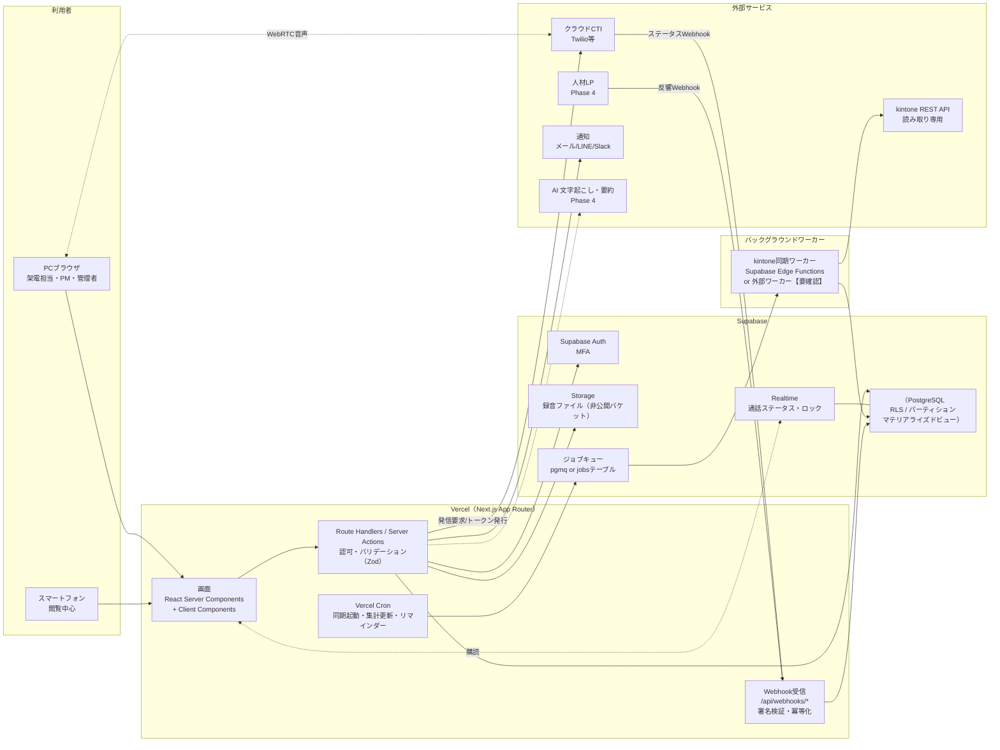
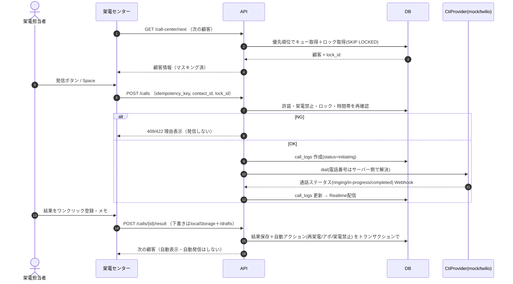

# 02. システム全体構成図

## 1. 全体構成

## 2. 主要な設計判断

| テーマ | 方針 | 理由 |
|---|---|---|
| レンダリング | 一覧・ダッシュボードは Server Components でサーバー取得。架電センターは Client Component 中心 | 大量データをクライアントに持たない／架電はリアルタイム操作 |
| 認可 | ①ミドルウェアでセッション確認 ②API でロール/スコープ判定 ③RLS | 指示書14「API・DB側でもチェック」 |
| DB アクセス | ユーザー操作はユーザーJWTで（RLS適用）。同期・集計ジョブのみ service_role | RLS を迂回しない |
| CTI 抽象化 | `CtiProvider` インターフェース（`initDevice / dial / hangup / mute / onStatus / fetchRecording`）。`MockCtiProvider` と `TwilioCtiProvider` | 特定サービスに依存しない（指示書03,07） |
| リアルタイム | Supabase Realtime で「顧客ロック」「通話ステータス」「新規反響通知」を配信 | 同時架電防止・即時反映 |
| 集計 | 日次×担当者×リストの集計テーブル（`kpi_daily_*`）を 5分毎に増分更新＋当日分はライブ集計 | ダッシュボード 2 秒以内 |
| 大量データ | `call_logs`・`audit_logs` は月次レンジパーティション。一覧はキーセットページネーション | 数百万件以上を想定 |
| 検索 | 電話番号は正規化列＋B-tree、氏名は `pg_trgm` GIN、メールは正規化列＋B-tree | 25万〜100万件で部分一致検索 |
| ジョブ | `jobs` テーブル（または pgmq）＋ワーカー。リトライ・指数バックオフ・デッドレター | 同期失敗・API制限への対応 |
| 秘密情報 | Vercel 環境変数（暗号化）。管理画面で入力するトークンは Supabase Vault に保存し、画面には末尾4桁のみ表示 | 指示書08,15 |

## 3. 架電の処理シーケンス

## 4. 環境

| 環境 | 用途 | データ | CTI | kintone |
|---|---|---|---|---|
| local | 開発 | 架空データ（seed 25万件生成スクリプト） | mock | mock（サンプルJSON） |
| preview（Vercel Preview） | PR 確認 | 架空データ（小） | mock | mock |
| staging | 受入・負荷試験 | 架空データ 25万〜100万件 | Twilio テスト用認証情報【Phase 2】 | 検証用 kintone アプリ【要確認】 |
| production | 本番 | 許諾済み実データ | 本番 | 本番（読み取り専用） |

## 5. セキュリティ構成（指示書15対応）

| 要件 | 実現方法 |
|---|---|
| ログイン認証 / MFA | Supabase Auth。管理者・PM は TOTP 必須（未設定時は設定画面へ強制遷移） |
| RLS | 全テーブル有効。ロール・チーム・担当割当に基づくポリシー |
| 通信暗号化 | HTTPS（Vercel）、DB接続 TLS |
| マスキング | 表示用ビュー／API レスポンスでロール別にマスク。電話番号は発信時にサーバー側で解決し、クライアントに全桁を渡さない設定を可能に【仮】 |
| CSV出力制限 | `export` 権限保持者のみ。件数上限・承認フロー【仮】、`export_logs` に記録 |
| 操作ログ | 重要操作は `audit_logs` にトリガーとアプリ層の両方で記録 |
| 自動ログアウト | 無操作 30 分【仮】 |
| バックアップ・復元 | Supabase PITR、月1回の復元リハーサル |
| 保管期限・削除・訂正 | `retention_policies` 設定＋削除ジョブ。削除時は架電禁止情報（ハッシュ）のみ残す |
| Webhook | 署名検証（Twilio署名 / LP用 HMAC）、`webhook_events` で重複排除 |
