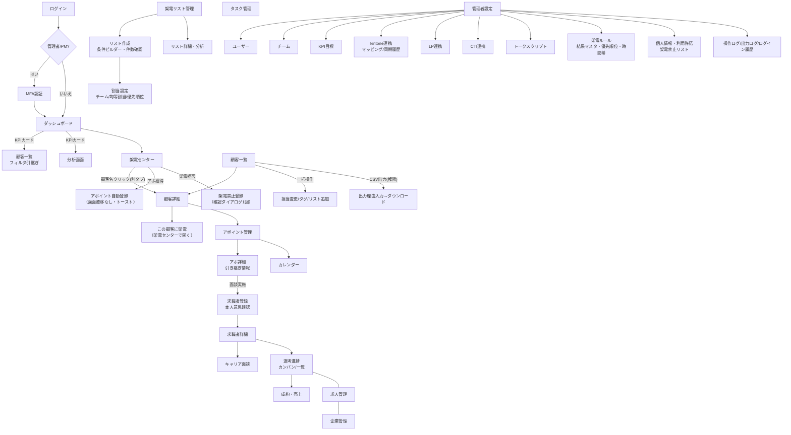

# 03. 画面遷移図・画面一覧

## 1. 画面遷移図



## 2. 画面一覧

| ID | 画面 | パス | Phase | 主な利用者 |
|---|---|---|---|---|
| S-01 | ログイン / MFA | `/login` | 1 | 全員 |
| S-02 | ダッシュボード | `/dashboard` | 1 | 全員（内容はロール別） |
| S-03 | 架電センター | `/call-center` | 1 | 架電担当・TL |
| S-04 | 顧客一覧 | `/contacts` | 1 | 全員（範囲は権限別） |
| S-05 | 顧客詳細 | `/contacts/[id]` | 1 | 全員 |
| S-06 | 架電リスト一覧 / 作成 / 詳細 | `/call-lists` | 1 | PM・TL |
| S-07 | アポイント管理 | `/appointments` | 1 | 架電担当・CA・TL |
| S-08 | カレンダー | `/calendar` | 1 | 全員 |
| S-09 | タスク管理 | `/tasks` | 1 | 全員 |
| S-10〜15 | 求職者／面談／求人／企業／選考／成約・売上 | `/candidates` 等 | 3 | CA・PM |
| S-16〜20 | 営業分析／担当者別／リスト別／時間帯別／流入経路別 | `/analytics/*` | 1(基本)・2(詳細) | PM・TL・経営 |
| S-21〜30 | 管理者設定 10画面 | `/admin/*` | 1（kintone/LP/CTIは2・4） | 管理者・PM |

## 3. 架電センター レイアウト（1366×768 基準）

```text
┌ サイドバー(折りたたみ 56px) ┬────────────────────────────────────────────────────────────────┐
│                            │ ヘッダー 48px：本日 架電 32 / 接続 11 / アポ 2 ｜ 目標進捗バー ｜ [デモ通話] バッジ │
│                            ├──────────────┬───────────────────────────────┬──────────────────┤
│                            │ 左 280px      │ 中央 (可変)                     │ 右 340px          │
│                            │ [本日][再架電] │ 山田 太郎  (35) 東京都          │ 架電結果           │
│                            │ [新規][未対応] │ 090-****-1234  許諾:済 ✓        │ [1]不在 [2]留守電  │
│                            │ ──────────── │ 初回:2024/05 流入:住宅LP-A      │ [3]話し中 [4]本人外│
│                            │ ● 鈴木 一郎   │ ┌────────────────────┐   │ [5]接続 [6]意向あり │
│                            │   再架電 14:00 │ │ ▶ 発信 (Space)       │   │ [7]将来検討 [8]再架電│
│                            │ ○ 佐藤 花子   │ │ 00:00 ミュート 終話   │   │ [9]アポ獲得 …       │
│                            │ ○ …          │ └────────────────────┘   │ ── 結果別入力欄 ── │
│                            │              │ [トークスクリプト] [履歴] [メモ] タブ │ 次回架電日時/アポ日時│
│                            │ 残り 148件    │                               │ [保存して次へ ⌘Enter]│
└────────────────────────────┴──────────────┴───────────────────────────────┴──────────────────┘
```

### キーボードショートカット（初期値）
| キー | 操作 |
|---|---|
| `Space`（入力欄外） | 発信／（通話中）何もしない ※誤終話防止 |
| `Esc` 長押し or `Ctrl+E` | 終話 |
| `M` | ミュート切替 |
| `1`〜`9`, `0`, `Shift+1..6` | 架電結果の選択 |
| `Ctrl+Enter` | 保存して次へ |
| `Ctrl+S` | 下書き保存（自動保存は 3 秒毎にも実行） |
| `?` | ショートカット一覧 |

## 4. ステータスカラー定義（全画面共通）

| 区分 | 色（Tailwind） | 該当ステータス |
|---|---|---|
| 未着手 | `slate-400` | 未架電 |
| 不通系 | `amber-500` | 不在・留守番電話・話し中・本人以外が応答・電話番号不通 |
| 前進 | `blue-600` | 接続・ヒアリング済、転職意向あり、将来的に検討、再架電希望 |
| 成果 | `emerald-600` | アポイント獲得、内定、内定承諾、入社、売上確定、入金済み |
| 停止 | `rose-600` | 転職意向なし、対象外、クレーム、架電拒否、辞退・失注 |
| 要確認 | `violet-600` | 利用許諾未確認 |

ベースカラー：背景 `white` / サーフェス `slate-50` / 枠線 `slate-200` / 本文 `slate-900` / アクセント `#1E3A8A`（navy）・`#2563EB`（blue）。
フォント：`Noto Sans JP`（本文 14px・行間 1.6）、数字は `tabular-nums`。

## 5. 状態設計（全画面）
- ローディング：スケルトン（テーブル行・KPIカード形状）。300ms 未満は表示しない。
- 空データ：理由と次の操作（例：「本日の架電対象はありません。リスト管理者に割り当てを依頼してください」）。
- エラー：何が起きたか＋再試行ボタン。架電センターでは入力内容を保持したまま「未送信 n 件」を表示し自動再送。
- 権限なし：403 画面（メニューは非表示が原則）。
