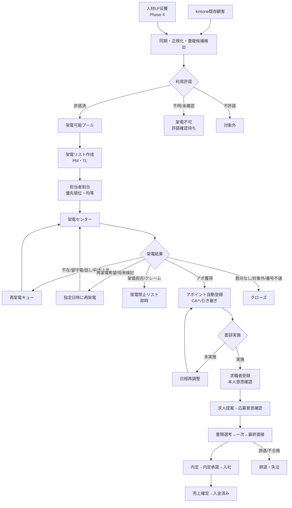
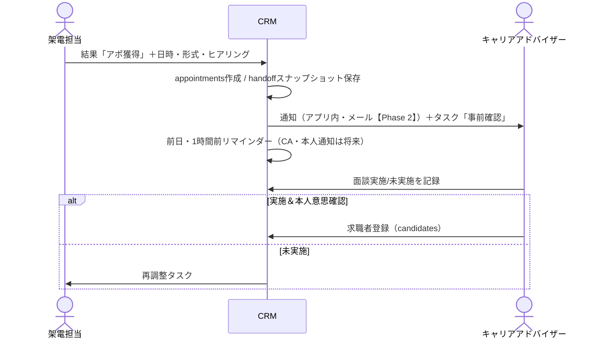

# 04. 営業業務フロー

## 1. 全体フロー（データ取得〜売上）

## 2. 架電結果 → 自動アクション定義（初期値・マスタで変更可）

| # | 架電結果 | 接続扱い | 表示する入力欄 | 自動アクション | キュー戻し【仮】 |
|---|---|---|---|---|---|
| 1 | 未架電 | – | – | （初期状態） | – |
| 2 | 不在 | ✕ | メモ | 再架電候補に登録 | 翌営業日・別時間帯（3回目以降は+2日） |
| 3 | 留守番電話 | ✕ | メモ | 再架電候補 | 翌営業日 |
| 4 | 話し中 | ✕ | – | 再架電候補 | 30分後 |
| 5 | 本人以外が応答 | ✕ | 応答者メモ・推奨時間帯 | 再架電候補 | 推奨時間帯 or 翌営業日 |
| 6 | 接続・ヒアリング済み | ○ | ヒアリング項目 | – | 担当判断（次回日時任意） |
| 7 | 転職意向あり | ○ | ヒアリング・希望時期・職種 | 優先度を上げる | 次回日時必須 |
| 8 | 将来的に転職を検討 | ○ | 検討時期 | 指定時期に再架電 | 次回日時必須 |
| 9 | 再架電希望 | ○ | 希望日時 | 再架電予定登録 | 指定日時 |
| 10 | アポイント獲得 | ○ | アポ日時・形式・URL・CA・ヒアリング | アポイント登録＋CAへ引き継ぎ通知＋タスク作成 | キューから除外 |
| 11 | 転職意向なし | ○ | 理由 | クローズ | 再架電抑止 180日【仮】 |
| 12 | 電話番号不通 | ✕ | – | 電話番号を無効フラグ | 除外 |
| 13 | 対象外 | – | 理由 | クローズ | 除外 |
| 14 | クレーム | ○ | 内容（必須） | 架電禁止登録＋TL・管理者に通知 | 除外 |
| 15 | 架電拒否 | ○ | – | **即時**架電禁止登録（suppression_list） | 除外 |
| 16 | 利用許諾未確認 | – | メモ | 架電不可に戻し、許諾確認タスク作成 | 除外 |

- 再架電の最大回数【仮：不通系 6 回】に達したら「架電上限」で自動クローズ。
- 「接続扱い」○ の結果のみ KPI の接続数に計上。

## 3. 架電センターの1件あたりの操作フロー（目標 3 操作）

1. 次の顧客が自動表示（ロック取得済み）→ 内容確認
2. **発信**（Space）→ 通話 → 終話（相手終話は自動検知）
3. 結果キー（例 `9`）→ 必要欄のみ入力 → **保存して次へ**（Ctrl+Enter）

ロック：表示時に取得、TTL 10 分【仮】（操作でハートビート延長）。保存・スキップ・離脱で解放。

## 4. アポイント引き継ぎフロー

## 5. 架電リスト作成・割当フロー
1. PM が条件ビルダーで条件指定 → 件数プレビュー（除外内訳：架電禁止 n／許諾未確認 n／対応中 n）
2. 名称・優先度・静的/動的を指定して保存
3. チーム割当 → 担当者へ均等割当（または TL が手動調整）
4. 動的リストは 1 時間毎【仮】に再評価し、新規該当者を追加（既存割当は維持）
5. 一時停止中のリストはキューに出さない

## 6. 利用許諾・架電禁止フロー
- 許諾状態：`unknown`（初期）／`granted`／`denied`／`withdrawn`。`granted` のみ架電可。
- 許諾の付与は「個人情報・利用許諾管理」画面で、根拠（同意取得日・取得手段・規約版）を記録した上で行う（一括付与は管理者のみ・監査ログ必須）。
- 架電禁止は電話番号（正規化値のハッシュ）単位でも登録し、同じ番号の別レコードにも適用。
