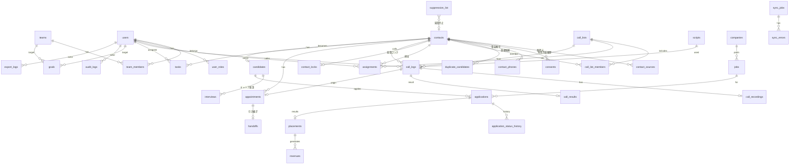

# 05. データベースER図・テーブル定義

指示書17の23テーブルを基本に、設計上必要な補助テーブル（★）を追加。全テーブル共通列：
`id uuid PK default gen_random_uuid()`, `created_at timestamptz`, `updated_at timestamptz`, `created_by uuid`（必要なもの）。

## 1. ER図

## 2. テーブル定義（主要列）

### 組織・ユーザー
| テーブル | 主要列 | 制約・インデックス |
|---|---|---|
| users | auth_user_id(FK auth.users), name, email, status(active/suspended), last_login_at | UNIQUE(auth_user_id), UNIQUE(email) |
| user_roles★ | user_id, role(enum: admin/pm/team_leader/caller/career_advisor/executive) | UNIQUE(user_id, role) |
| teams | name, base_location(拠点), parent_team_id | 拠点・階層に対応 |
| team_members★ | team_id, user_id, is_leader | UNIQUE(team_id, user_id) |

### 顧客
| テーブル | 主要列 | 制約・インデックス |
|---|---|---|
| contacts | last_name, first_name, kana, email_normalized, area_pref, area_city, first_inquiry_at, primary_source, consent_status(enum), callable(bool 生成/更新トリガー), job_change_intent, tags text[], owner_user_id, last_called_at, call_count, last_call_result, next_call_at, data_quality_flags, deleted_at | GIN(kana gin_trgm_ops), (email_normalized), (consent_status, callable, next_call_at), (owner_user_id, next_call_at), (first_inquiry_at), (primary_source) |
| contact_phones★ | contact_id, phone_e164, phone_hash, type(mobile/home), is_valid, is_primary | INDEX(phone_e164), INDEX(phone_hash) |
| contact_sources | contact_id, source_system(kintone/lp/manual), source_app_id, source_record_id, source_updated_at, raw_snapshot jsonb(許可項目のみ), utm jsonb, lp_id, ad_media | **UNIQUE(source_system, source_app_id, source_record_id)** ← 同期の冪等キー |
| consents | contact_id, purpose(jinzai_sales等), status(granted/denied/withdrawn/unknown), basis(同意取得手段), terms_version, obtained_at, recorded_by, evidence_ref | INDEX(contact_id, obtained_at desc)。履歴は追記のみ |
| suppression_list | phone_hash, email_hash, contact_id(null可), reason(refusal/complaint/legal/request), registered_by, registered_at, expires_at(null=無期限) | UNIQUE(phone_hash) WHERE active。発信前チェックで参照 |
| duplicate_candidates★ | contact_id_a, contact_id_b, match_keys(phone/email/name), score, status(pending/merged/not_duplicate), reviewed_by | UNIQUE(least(a,b), greatest(a,b)) |

### 架電
| テーブル | 主要列 | 制約・インデックス |
|---|---|---|
| call_lists | name, type(static/dynamic), filter_definition jsonb(AND/OR木), team_id, priority, status(active/paused/archived), refreshed_at | |
| call_list_members | call_list_id, contact_id, added_at, removed_at, priority_score | UNIQUE(call_list_id, contact_id) |
| assignments | contact_id, user_id, call_list_id, assigned_at, released_at, reason | 部分UNIQUE(contact_id) WHERE released_at IS NULL（現担当は1人） |
| contact_locks★ | contact_id PK, user_id, acquired_at, expires_at | 同時架電防止。PKで一意 |
| call_logs | contact_id, user_id, call_list_id, script_id, direction(out/in), provider(mock/twilio), provider_call_id, phone_e164, status(initiating/ringing/in_progress/completed/failed/no_answer/busy), started_at, answered_at, ended_at, duration_sec, is_demo, idempotency_key | **月次パーティション(started_at)**, UNIQUE(idempotency_key, started_at), UNIQUE(provider, provider_call_id, started_at), INDEX(user_id, started_at), INDEX(contact_id, started_at) |
| call_results★ | call_log_id, contact_id, result_code(FK call_result_masters), is_connected, hearing jsonb, memo, next_action_at, saved_by, saved_at | UNIQUE(call_log_id) ←結果の二重登録防止 |
| call_result_masters★ | code, label, category, is_connected, required_fields jsonb, auto_action jsonb, sort_order, shortcut_key, active | 架電ルール設定で編集 |
| call_recordings | call_log_id, storage_path, duration_sec, consent_announced(bool), retention_until, transcript_status | UNIQUE(call_log_id) |
| call_drafts★ | user_id, contact_id, payload jsonb, updated_at | 入力途中の自動保存 |

### アポイント・タスク
| テーブル | 主要列 | 制約・インデックス |
|---|---|---|
| appointments | contact_id, origin_call_log_id, booked_by, advisor_user_id, scheduled_at, method(online/phone/visit), meeting_url, status(scheduled/rescheduled/canceled/done/no_show), done_at | INDEX(advisor_user_id, scheduled_at), INDEX(scheduled_at) |
| handoffs★ | appointment_id, snapshot jsonb(顧客要約・ヒアリング), from_user_id, to_user_id, acknowledged_at | |
| tasks | contact_id, assignee_id, type, title, due_at, status, related_type/id | INDEX(assignee_id, status, due_at) |

### 人材事業（Phase 3。テーブルは Phase 1 で作成）
| テーブル | 主要列 |
|---|---|
| candidates | contact_id(UNIQUE), intent_confirmed_at, confirmed_by, desired_job, desired_timing, current_status, advisor_user_id |
| interviews★ | candidate_id, appointment_id, advisor_user_id, held_at, summary, next_step |
| companies | name, industry, contact_person, contract_terms(fee_rate, refund_policy jsonb) |
| jobs | company_id, title, location, salary_min/max, fee_rate, status |
| applications | candidate_id, job_id, status(FK application_status_masters), status_changed_at | UNIQUE(candidate_id, job_id) |
| application_status_history★ | application_id, from_status, to_status, changed_by, changed_at | 滞留・歩留まり分析 |
| placements | application_id(UNIQUE), offer_accepted_at, join_date, fee_amount, refund_deadline |
| revenues | placement_id, amount, status(forecast/confirmed/invoiced/paid/refunded), confirmed_at, due_date, paid_at |

### 設定・目標・ログ
| テーブル | 主要列 | 備考 |
|---|---|---|
| goals | scope(user/team/org), user_id, team_id, period(YYYY-MM), metric, target_value | UNIQUE(scope, user_id, team_id, period, metric) |
| scripts | title, body(markdown), version, active, list_ids | 変更時に version を上げる |
| call_rules★ | key, value jsonb | 架電時間帯、再架電間隔、最大回数、ロックTTL、優先順位 |
| integration_settings★ | service, mode(mock/live), config jsonb(秘密情報は Vault 参照のみ) | |
| sync_jobs | type(full/delta/manual), status, cursor_id, last_source_updated_at, total, processed, inserted, updated, skipped, error_count, started_at, finished_at | |
| sync_errors★ | sync_job_id, source_record_id, error_code, message, retry_count, resolved | |
| field_mappings★ | source_app_id, source_field, target_field, transform, allowed(bool) | 禁止項目は allowed=false 固定 |
| webhook_events★ | provider, event_id, received_at, processed_at | UNIQUE(provider, event_id) で重複排除 |
| audit_logs | actor_id, action, target_type, target_id, diff jsonb(個人情報はマスク), ip, user_agent, occurred_at | **月次パーティション**, INDEX(actor_id, occurred_at), INDEX(target_type, target_id) |
| export_logs★ | actor_id, resource, filter jsonb, row_count, reason, exported_at | |
| login_history★ | user_id, event(login/logout/failed/mfa), ip, user_agent, occurred_at | |
| kpi_daily★ | date(JST), user_id, team_id, call_list_id, source, hour, calls, unique_contacts, connects, appointments, talk_sec | 集計キャッシュ。UNIQUE(全次元) |

## 3. 設計メモ
- **callable（架電可能）判定**：`consent_status='granted' AND NOT suppressed AND phone有効 AND deleted_at IS NULL`。トリガーで `contacts.callable` を更新し、発信時は関数 `can_call(contact_id)` で再確認。
- **キュー取得**：`SELECT ... FOR UPDATE SKIP LOCKED` ＋ `contact_locks` INSERT で同時割当を防止。
- **金融情報**：kintone の住宅ローン審査・借入・資産系フィールドは `field_mappings.allowed=false` で取り込まない（DB に列自体を作らない）。
- **パーティション**：`call_logs` と `audit_logs` は `pg_partman` で月次作成。古いパーティションは保管期限に従いアーカイブ。
- **100万件想定**：contacts 100万・call_logs 年間 500万件程度を想定しインデックス設計。負荷試験で確認。
